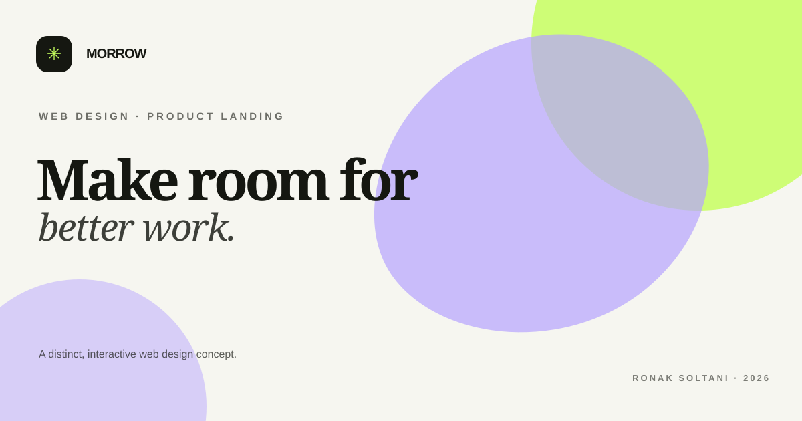

# Morrow

> WEB DESIGN · PRODUCT LANDING

A considered launch page for a calm, capable project workspace. Built to make the product feel clear before the first click.

A complete, dependency-free portfolio project by **Ronak Soltani**. This repository contains runnable source code, a product brief, usage notes and an original social preview.

## Project at a glance

- **Track:** Web design case study
- **Status:** Portfolio concept, version 1.0
- **Stack:** semantic HTML, modern CSS and vanilla JavaScript
- **Dependencies:** none
- **Network requests from the app:** none

## Run it locally

1. Clone or download this repository.
2. Open `index.html` in a modern browser.
3. If your browser restricts local file features, run `python -m http.server 8000` from this folder and open `http://localhost:8000`.

No package installation or build step is required.

## What you can explore

- Adjust the team size to explore a sample pricing state.
- Responsive layout, semantic landmarks, keyboard focus styles and reduced-motion support.
- Original interface artwork made with CSS; `preview.svg` is also used as the project icon.
- Copy and file-export controls where the browser supports them.

## How it works

A team-size slider updates a clearly marked sample plan estimate; the primary action opens a local demo message.

## Design and engineering notes

Lead with one human outcome, then show a compact product preview and let the visitor explore pricing without a signup wall.

## Privacy and data scope

This is a static, front-end project. The application code makes no analytics, API or server requests. Pasted text, selected CSV/XML files and demo preferences are processed in the browser. Saved preferences use this browser profile’s local storage when applicable. No account or backend is included.

The brand, business, prices, schedules, products, testimonials, and metrics in this interface are fictional sample content. This is a design case study, not a live business.

## Scope and limitations

Fictional product and pricing. No subscription, account or checkout exists.

Read [PROJECT-PLAN.md](PROJECT-PLAN.md) for the audience, interaction flow, design rationale and next iteration.

## Project files

- `index.html` — page structure, content and accessible controls.
- `styles.css` — layout, responsive states, color system and original CSS artwork.
- `app.js` — project-specific interaction logic and browser-local utilities.
- `preview.svg` — original social-preview graphic and SVG favicon.
- `PROJECT-PLAN.md` — product brief, decisions, boundaries and roadmap.
- `CONTRIBUTING.md` — lightweight contribution guidance.
- `.editorconfig` and `.gitignore` — editor consistency and generated-file exclusions.

## Accessibility

The interface includes a skip link, landmark structure, labelled controls, visible keyboard focus and reduced-motion handling. This is a starting point, not a substitute for assistive-technology testing with real users.

## License

Released under the MIT License. See [LICENSE](LICENSE).
